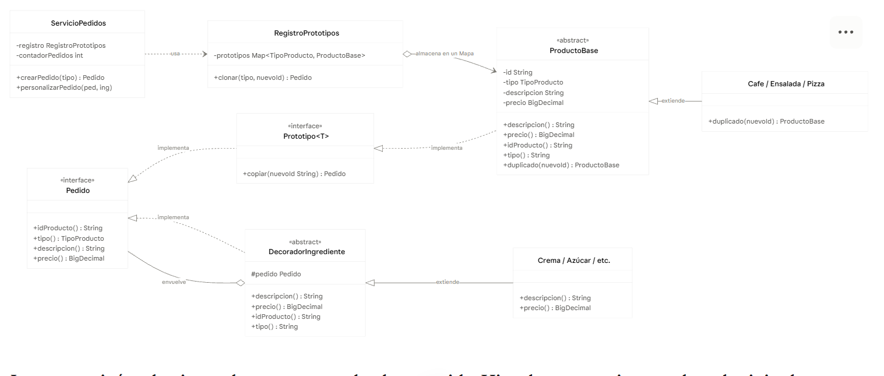
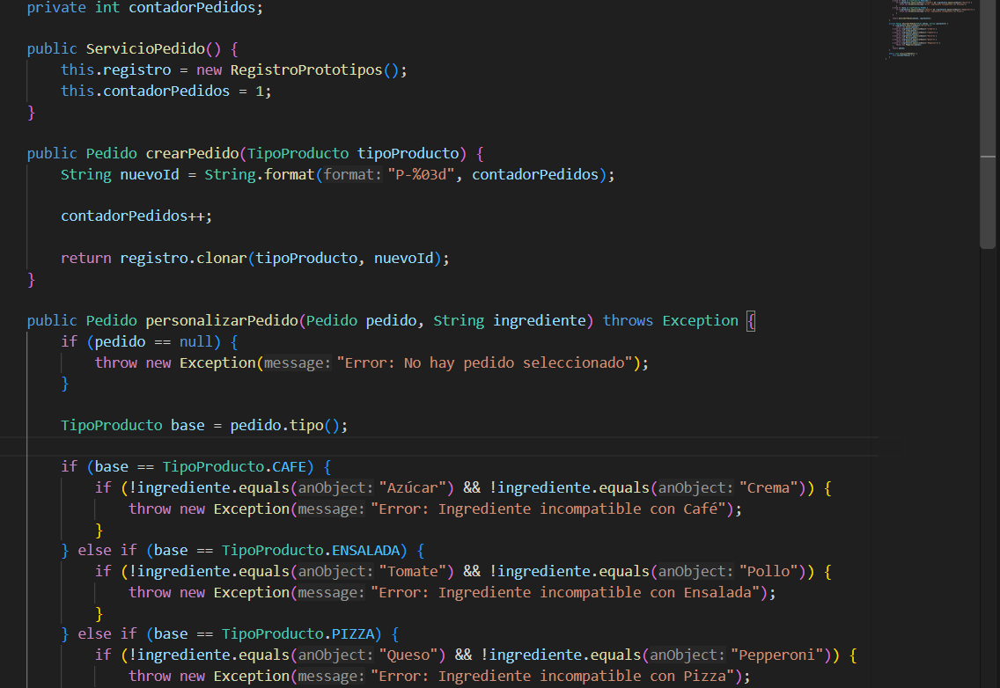
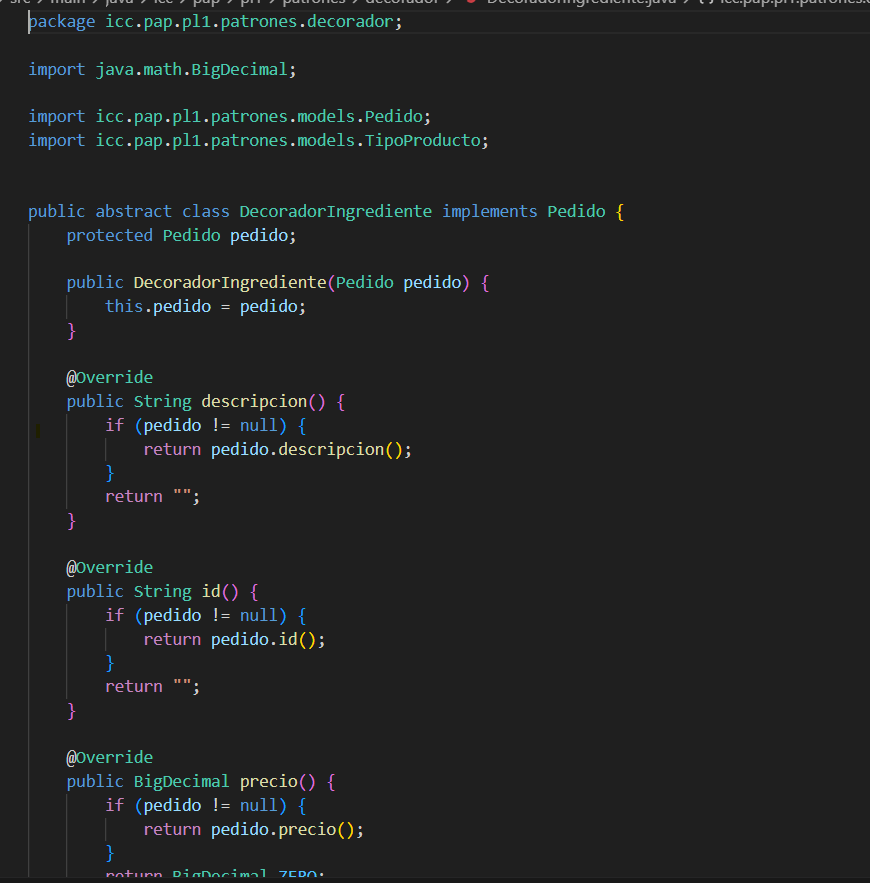
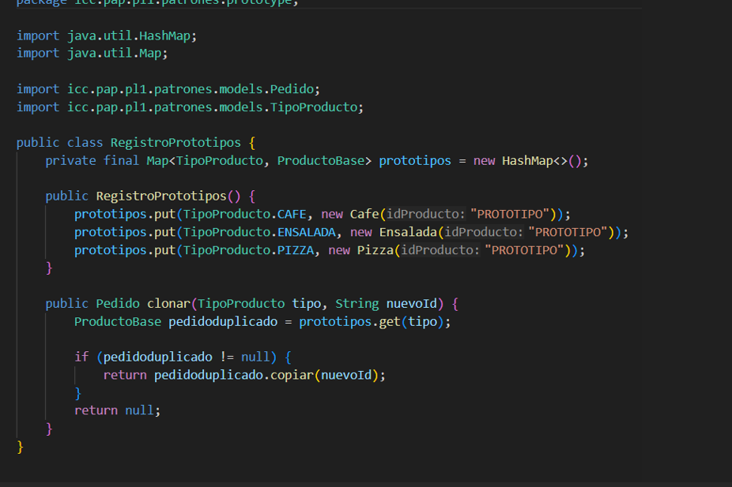

# Evidencias APP1 — PedidoLab

**Repositorio:** [enlace Git por completar]  
**Integrantes:**  
**Fecha:**
## Casos de prueba y evidencias

| Caso | Entrada | Resultado esperado | Resultado real | Evidencia | Estado |
|---|---|---|---|---|---|
| CA01 | Clonar Café dos veces | IDs diferentes; ambos empiezan en $2.20 | P-001 y P-002, ambos en $2.20 |  | Aprovado |
| CA02 | Comparar clon y objeto del registro | Referencias distintas; el prototipo conserva su configuración | Referencias distintas; el prototipo sigue en su valor base |  | Aprovado |
| CA03 | Al primer Café agregar Azúcar y Crema | Descripción incluye los dos ingredientes; total $3.90 | La descripción muestra Azúcar y Crema; total $3.90 |  | Aprovado |
| CA04 | Consultar el segundo Café sin ingredientes | Mantiene $2.20, sin ingredientes | $2.20, "Sin ingredientes" |  | Aprovado |
| CA05 | Clonar Ensalada y agregar Tomate y Pollo | Total $5.60 | Total $5.60 |  | Aprovado |
| CA06 | Clonar Pizza y agregar Queso y Pepperoni | Total $7.10 | Total $7.10 |  | Aprovado |
| CA07 | Intentar agregar Queso a Café | Operación rechazada; total y descripción no cambian | Aparece el error; el pedido queda igual |  | Aprovado |
| CA08 | Agregar ingrediente sin pedido seleccionado | Mensaje claro y ningún cambio de estado | Aparece el aviso; no cambia nada |  | Aprovado |
| CA09 | Solicitar clon de clave inexistente | Fallo controlado; no se crea pedido | Devuelve null; no se crea pedido | [Captura 09](evidencias/CA09.png) | No hay alguna opcion que nos deje buscar ese |
| CA10 | Agregar dos veces Azúcar a un Café | Total $3.20 y dos aplicaciones del decorador | Total $3.20; Azúcar aparece dos veces |  | Aprovado |
| CA11 | Reiniciar y volver a clonar Café | Nuevos pedidos parten nuevamente del valor base $2.20 | El nuevo Café es P-001 y vale $2.20 |  | Aprovado |

## Identificación de patrones

- **Prototype:** clase, método y archivo donde se registra el prototipo y se genera la copia.

Aqui podemos observar la clase y el metodo el cual nos permite generar la copia

- **Decorator:** clase abstracta, referencia al componente y dos decoradores concretos.

- **Integración:** método de servicio donde un clon recibe al menos dos decoradores.

## Decisiones de diseño

1. **Prototype con un registro central.** `RegistroPrototipos` guarda un prototipo de cada producto (Café, Ensalada y Pizza) en un mapa indexado por `TipoProducto`los pedidos no se construyen desde cero: `ServicioPedido.crearPedido` pide `clonar(tipo, nuevoId)`que llama a `copiar(nuevoId)` sobre el prototipo así cada pedido es independiente, el prototipo nunca se modifica y, si el tipo no existe, `clonar` devuelve `null` y no se crea ningún pedido.

2. **Lógica de negocio en el servicio, no en la ventana.** `ServicioPedido` genera los IDs (P-001, P-002…), valida que el ingrediente sea compatible con el producto y aplica el decorador correspondiente 

## Conclusiones

1. Con este proyecto aprendí cómo funciona el patrón Prototype. Me ayudó a ver que se pueden crear varios pedidos a partir de un mismo modelo sin que se afecten entre sí.

2. También entendí el patrón Decorator, que permite agregar ingredientes a un pedido sin crear una clase nueva para cada combinación posible.

3. Por último, vi que separar la interfaz de la lógica del programa hace que el código sea más ordenado y más fácil de probar.
